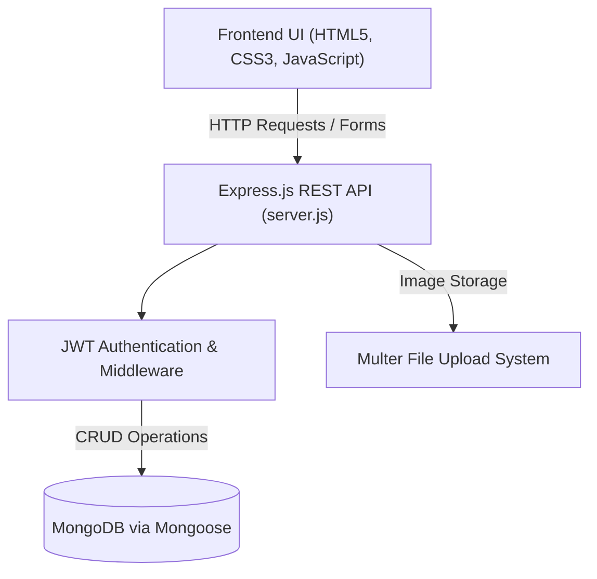

# 🚗 CarWale — Automotive Marketplace & Car Valuation Platform

[](https://opensource.org/licenses/MIT)
[](https://nodejs.org/)
[](https://expressjs.com/)
[](https://www.mongodb.com/)
[](https://jwt.io/)

> **A full-stack automotive portal and marketplace enabling users to browse, filter, inspect specifications, and list new and pre-owned vehicles with authenticated user profiles and media uploads.**

---

## 📌 Key Features

- **🔍 Intelligent Vehicle Filtering**: Filter by brand, fuel type (Electric, Petrol, Diesel, Hybrid), price range, and transmission.
- **🔐 Secure Authentication**: JWT (JSON Web Tokens) and bcrypt hashed passwords for dealer and user accounts.
- **📸 Multi-Image Uploads**: Integrated Multer storage pipeline for high-resolution vehicle listings.
- **🗄️ MongoDB Schemas**: Robust Mongoose schemas for cars, users, reviews, and test drive bookings.
- **🌱 Seed Generator**: Instant test catalog generator (`seed.js`) with realistic car specs, pricing, and images.

---

## 🏗️ Architecture



---

## 🛠️ Tech Stack

- **Frontend**: HTML5, Vanilla JavaScript, CSS3
- **Backend**: Node.js, Express.js
- **Database**: MongoDB, Mongoose ORM
- **Authentication**: JSON Web Tokens (`jsonwebtoken`), `bcryptjs`
- **File Handling**: `multer`

---

## 📁 Repository Structure

```text
CarWale/
├── css/             # Stylesheets for home, catalog, and auth pages
├── js/              # Client-side API interactions and rendering logic
├── middleware/      # JWT auth guard and upload handlers
├── models/          # Mongoose models (User, Car, Booking)
├── routes/          # Express route controllers (/api/cars, /api/auth)
├── index.html       # Car exploration & marketplace catalog
├── login.html       # User signin & registration portal
├── package.json     # NPM configuration and dependencies
├── seed.js          # Catalog populator
├── server.js        # Express application entry point
├── LICENSE          # MIT Open Source License
└── README.md        # Project documentation
```

---

## 🚀 Getting Started

### Prerequisites
- Node.js (v18.0.0 or higher)
- MongoDB instance (local `mongodb://localhost:27017` or MongoDB Atlas)

### Installation

1. **Clone the repository:**
   ```bash
   git clone https://github.com/MahirMavani/CarWale.git
   cd CarWale
   ```

2. **Install dependencies:**
   ```bash
   npm install
   ```

3. **Configure Environment Variables:**
   Create a `.env` file in the root directory:
   ```env
   PORT=5000
   MONGO_URI=mongodb://localhost:27017/carwale
   JWT_SECRET=your_jwt_secret_key
   ```

4. **Seed the database (Optional):**
   ```bash
   npm run seed
   ```

5. **Start the server:**
   ```bash
   npm start
   ```
   Open `http://localhost:5000` in your web browser.

---

## 📄 License

Distributed under the [MIT License](LICENSE).
